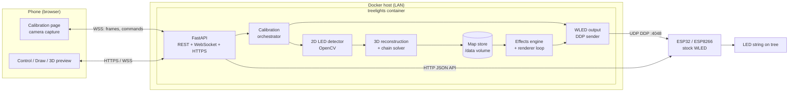
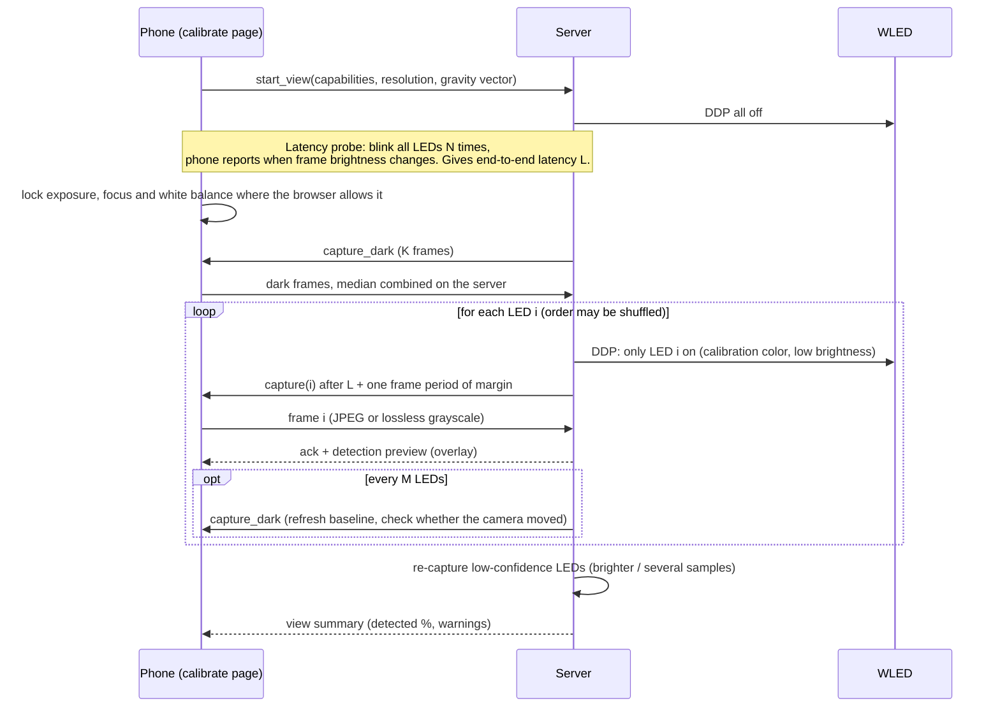

# TreeLights — Architecture

Status: **DRAFT — awaiting approval.** No implementation code exists yet. Section 13 lists the open questions.

## 1. Goals

1. **Map the tree.** Use a phone camera to find where every addressable LED on a Christmas tree sits in 3D.
2. **Stock WLED only.** Drive the LEDs through unmodified WLED firmware, using only features WLED already has: its realtime UDP protocols and its JSON API.
3. **Self-hosted.** Run everything in one Docker container on a computer on the same LAN. Nothing needs the internet.
4. **Resilient to noise.** Mapping should cope with reflections, ambient light changes, other light sources, occluded LEDs, a slightly moving phone, and the occasional bad detection.
5. **Physically bounded.** LEDs `i` and `i+1` are joined by a wire of fixed length, so they can never be more than `d_max` apart. The solver enforces that bound.
6. **Use the 3D map for effects.** Examples are drawing on the tree from a phone, 3D animations such as falling balls, and rotation effects that follow the tree's surface.

### Non-goals (v1)

- Custom WLED firmware or usermods.
- Cloud hosting or access from outside the LAN.
- A native phone app. The phone runs a web app in its browser.

## 2. System overview



A single container serves the web app, the API, calibration, reconstruction and the realtime effects renderer. When the server isn't streaming, WLED falls back to its own effects and presets after its realtime timeout, so the tree never stays dark because the server is down.

## 3. Driving WLED without modifying its firmware

| Purpose | Mechanism | Notes |
|---|---|---|
| Per-frame LED colors (calibration and effects) | **DDP** (Distributed Display Protocol), UDP port 4048 | WLED supports DDP natively. One packet holds up to 480 RGB pixels (1440 data bytes) at a byte offset. Larger strings use several packets, with the PUSH flag on the last one. Unicast, so it works on a Docker bridge network. |
| Fallback realtime protocol | WLED UDP realtime **DNRGB** (port 21324), or E1.31 | Only used if DDP turns out to be unreliable on a user's setup. |
| Discovery, info, LED count | JSON API `GET /json/info`, `/json/state`; mDNS `_wled._tcp` | Reads the LED count, version and name, and checks the realtime settings. |
| Power, presets, handing control back | JSON API `POST /json/state` | For example, restoring the user's preset after an effect session ends. |

**WLED settings the user needs** (Sync / LED preferences). Exact names vary between WLED versions, so the setup page shows a checklist and verifies what it can through `/json/cfg`:

- Receive UDP realtime: **on**.
- Realtime timeout: about 2.5 s, which is the default. After this long without data, WLED resumes its own effects.
- LED count matches the physical string.
- Turn off realtime gamma correction where the version offers that option. The server applies its own gamma so calibration brightness is predictable.
- Brightness and current limiting: the server applies its own global brightness cap and a power estimate. It doesn't rely on WLED's automatic brightness limiter (ABL) behaving the same way in realtime mode on every version.

**Multiple controllers.** The config holds a list of `{host, led_count, global_index_offset}` entries. The output stage splits each frame across them. v1 targets a single controller, but the data model supports more from the start.

**Target firmware:** WLED 0.14 or newer. The setup page reads the version and warns if it's older.

## 4. Deployment

- **One Docker image**, built in two stages: Node builds the web app, then a Python 3.12-slim runtime runs FastAPI and uvicorn with numpy, scipy, opencv-python-headless and zeroconf.
- **docker-compose.yml**
  - On Linux, `network_mode: host`, so that mDNS discovery and any multicast (E1.31) work.
  - On Docker Desktop for Mac or Windows, host networking is limited. Use bridge mode with published ports and enter the WLED IP by hand. DDP unicast works either way.
  - Volume `./data:/data` holds the config, the TLS cert, scans and maps.
  - Port `8443` serves HTTPS for the web app, API and WebSockets. Optional port `8080` serves plain HTTP that only redirects to HTTPS and serves a "trust this certificate" help page.
- **HTTPS is required.** Phone browsers only allow camera access (`getUserMedia`) in a secure context, and a plain `http://192.168.x.x` address isn't one.
  - On first start, the container generates a self-signed certificate whose SANs cover the host's LAN IPs and hostname. The user accepts the warning once on the phone.
  - The user can supply their own certificate instead, for example from mkcert or a local CA.
  - Section 5.6 describes a fallback that needs no camera permission.
- **Security:** intended for the LAN only. An optional shared PIN or token in the config protects the control pages.

## 5. Calibration: finding each LED in 2D

### 5.1 Capture setup

- Lighting: dim the room. Full darkness isn't required.
- The phone stays stationary for each **view**: on a tripod, or propped against something. One view takes about 1–2 minutes.
- The user makes about **6–8 views** spread around the tree, roughly every 45–60°, at about chest height. One or two higher or lower views help with LEDs deep inside branches.
- View positions don't need to be measured. Section 6 recovers the camera poses.
- Every view must use the **same camera and zoom level**, so all views can share one set of intrinsics.

### 5.2 Per-view capture protocol (sequential mode — the default)



**Robustness measures during capture:**

- **Exposure lock.** The page uses `MediaStreamTrack.applyConstraints` for manual or locked exposure where the browser supports it. Android Chrome generally does. iOS Safari support is limited, so the page shows a warning and relies more on the refreshed dark frames.
- **Low LED brightness for calibration.** Bright LEDs bloom and light up nearby branches. The server picks the brightness automatically: it raises it until a test set of LEDs is detected without saturating.
- **Dark baseline refreshed every M LEDs.** This absorbs slow ambient changes.
- **Movement detection.** Each new dark frame is compared with the first one using phase correlation. A shift of more than a few pixels pauses the view and tells the user. Because one view assumes a fixed camera, the user can restart the view or the server can split it into a new one.
- **Pipelining.** The server lights LED `i+1` while it is still analysing frame `i`, so throughput is limited by the camera, not by processing.
- **Raw frames are kept** (optional, on by default) so detection and reconstruction can be re-run with new parameters without re-scanning.

Estimated time: about 100–150 ms per LED. For 500 LEDs that is about 1–1.5 min per view, or about 10 min for 7 views.

### 5.3 2D detection (server, OpenCV)

For each `(view, LED)` frame:

1. `D = max(0, on − dark)`. Use the luminance channel, or the channel that matches the calibration color, which suppresses unrelated changes.
2. Apply a Gaussian blur with σ of about 1.5 px.
3. Set a robust threshold: `T = median(D) + k·MAD(D)`, with `k ≈ 8`, and never below an absolute floor.
4. Find connected components. Score each blob by peak SNR, area and compactness, and penalise saturated or very large blobs. Compute a sub-pixel, intensity-weighted centroid.
5. **Keep up to 3 candidates per frame instead of committing to one.** Reflections off ornaments or the wall produce second blobs. The 3D stage, which has multiple views and the chain constraint, decides which one is real.
6. Return "not seen" if no blob clears the threshold. That's normal for an LED hidden from this view.

Optional **temporal verification** for ambiguous frames: repeat the LED as on → off → on, and accept only blobs that follow the pattern. This rejects TV flicker, other blinking lights and people walking past.

### 5.4 Fast mode: binary-coded capture (phase 2)

All LEDs blink their index as a binary code at the same time, over `ceil(log2 N)` bits. Each bit is sent with its complement frame, so the threshold is per-pixel rather than global, and parity bits are added. That's about 20–25 frames per view instead of N. Each blob is decoded into an index. Blobs that decode badly or fail parity, and LEDs too close together to separate, fall back to sequential capture for just those indices. This is optional and builds on the same detector and pipeline.

### 5.5 Phone orientation

The phone sends its gravity vector from `DeviceMotionEvent` with each view. iOS asks for permission for this. The gravity vector gives a strong prior for the world "up" axis, as described in section 6.4. If it's unavailable, the system infers "up" from the shape of the point cloud.

### 5.6 Fallback: video upload (phase 2)

If camera access in the browser isn't possible, the user records a video in the phone's normal camera app while the server plays a known sequence: a sync preamble of full-tree flashes, then the LEDs one by one at a fixed rate. The video is uploaded and the server finds the preamble to align timing. Detection and everything after it is unchanged.

## 6. Reconstruction: from 2D views to a 3D map

Inputs: for each view `v` and LED `i`, 0–3 candidates `(u, v, score)`, plus the gravity vector for each view.

Because each LED's identity is known in every view, this is **structure-from-motion with known correspondences**. No feature matching is needed.

### 6.1 Camera intrinsics

- Pinhole model with one focal length `f`, the principal point fixed at the image center, and one radial distortion term `k1`. All views share these.
- Initial `f` assumes about a 70° horizontal field of view, typical of a phone's main camera. Bundle adjustment then refines it.
- A checkerboard calibration is not required. It could be added later as an optional improvement.

### 6.2 Incremental reconstruction

1. **Seed pair.** Pick the pair of views with the most high-confidence LEDs in common and a reasonable baseline. Use only each frame's best candidate. Find the essential matrix with RANSAC (`cv2.findEssentialMat`), recover the pose and triangulate.
2. **Register more views.** For each remaining view, run `solvePnPRansac` against the points triangulated so far, then triangulate the LEDs it adds.
3. **Bundle adjustment.** `scipy.optimize.least_squares` with a sparse Jacobian and a **robust loss** (Cauchy or soft-L1). It optimises all camera poses, `f`, `k1` and the 3D points.
4. **Candidate resolution.** With the cameras fixed, each LED's 2D candidates from every view are combined in a RANSAC triangulation. This produces a small set of 3D **hypotheses** per LED, each with an inlier count and a reprojection error.

### 6.3 Chain-constrained selection: enforcing `d_max`

Reconstruction treats LEDs independently. The wiring adds a strong prior: `‖p_i − p_{i+1}‖ ≤ d_max`.

The best consistent set of positions is found **exactly** as a **shortest path through a DAG**:

- **Nodes:** `(i, h)` for each LED `i` and each of its 3D hypotheses `h`.
- **Node cost:** a function of reprojection error and support. Fewer agreeing views and worse error cost more.
- **Edges:** from `(i, h)` to `(j, h')` for `i < j ≤ i + K_gap`, allowed only if `‖p_h − p_h'‖ ≤ (j − i)·d_max`. Skipping the LEDs in between costs `(j − i − 1)·c_missing`. This edge rule is how gaps are allowed.
- **Transition cost:** a small smoothness term that favours typical spacing, plus the hard limit above.

Dynamic programming finds the global optimum in `O(N · H² · K_gap)` time. This is cheap for thousands of LEDs. A single bad hypothesis can't win, because it would need impossible jumps to its neighbours.

### 6.4 Scale and world frame

- **Scale.** Structure-from-motion gives positions only up to an unknown scale, but `d_max` is measured in real units. The user provides **one** of:
  - the tree's height,
  - a measured distance between two LEDs they name,
  - or nothing. In that case the solver works in relative units and uses `d_max = α · median(consecutive spacing)`, with `α` adjustable and defaulting to 2.5. The scale estimate is then refined iteratively.
- **Up axis.** The average of the gravity vectors from all views, rotated into world coordinates. Fallback: the main axis of the point cloud from PCA (trees are taller than they are wide) together with a cone fit. The review UI has a "flip / rotate" control.
- **Origin.** The center of the trunk axis, at the height of the lowest LED.
- **Axes:** `y` points up, and `x`/`z` are horizontal. `+z` points toward view 0, so "front" means where the first scan was taken.

### 6.5 Refinement and gap filling

1. **Constrained refinement.** Re-run least squares on the chosen points, with the reprojection residuals plus a hinge penalty `w · max(0, ‖p_i − p_{i+1}‖ − d_max)²`.
2. **LEDs seen in only one view.** Depth along the camera ray is unknown. Place the LED at the point on its ray that best fits its neighbours' chain constraints (closest to the midpoint between its neighbours, within `d_max` of each).
3. **LEDs not seen in any view.** Interpolate along the chain between the nearest solved neighbours. A spline is clamped so that every gap stays within `d_max`, and pushed outward toward the tree's surface model. These LEDs are flagged `estimated`.
4. **Quality report.** For each LED: number of views, reprojection error, source (`measured` / `single_view` / `estimated`), and any constraint violations. Overall: RMS error and the share of LEDs measured.

### 6.6 Surface model

Rotation effects that follow the surface and drawing both need a model of the tree's outer surface:

- **Radius profile `r_s(h)`.** In height bins, take the about 90th percentile of the LEDs' horizontal distance from the axis, then smooth it and make it non-increasing toward the top. This gives a solid of revolution that is usually close to a cone.
- **Precomputed values for each LED:**
  - cylindrical coordinates `(h, θ, r)`,
  - normalised height `h_n ∈ [0, 1]`,
  - surface depth `r / r_s(h)`,
  - chain fraction `i / (N − 1)`,
  - k-nearest neighbours from a KD-tree.

## 7. Map review and verification

The **Map** page has a three.js 3D viewer of the point cloud. Points are colored by confidence or source, the chain is drawn as a polyline, and constraint violations are highlighted.

- **Click an LED** to light it on the real tree. The user can then drag it to a new position or mark it bad, which sends it back to gap filling.
- **Re-scan selected LEDs.** Captures new frames for just those indices from one or more new views, then re-solves.
- **Verification sweeps.** A horizontal plane rising up the tree, a vertical half-plane rotating around the axis, and a sphere growing from the center. The user watches the real tree. If the sweeps look clean, the map is good.
- **Versions.** Each solve writes a new map version. The user can roll back.

## 8. Map data format

`/data/maps/<map_id>/map.json`:

```json
{
  "version": 1,
  "id": "2026-12-01T19-30-00",
  "units": "cm",
  "scale_source": "tree_height",
  "d_max": 12.0,
  "frame": { "up": "y", "front": "+z", "origin": "trunk_base" },
  "controllers": [{ "host": "192.168.1.50", "led_count": 500, "offset": 0 }],
  "surface": { "h": [0, 10, 20], "r": [60, 57, 53] },
  "leds": [
    { "i": 0, "p": [12.1, 3.4, -40.2], "src": "measured", "views": 4, "err_px": 0.8 },
    { "i": 1, "p": [14.0, 4.1, -38.9], "src": "estimated", "views": 0, "err_px": null }
  ],
  "quality": { "rms_px": 1.1, "measured_frac": 0.94, "violations": 0 }
}
```

**Exports:** CSV (`i, x, y, z`), and the JSON above. **Phase 3:** a WLED 2D `ledmap.json` made by unwrapping `(θ, h)` onto a grid, so WLED's own built-in 2D effects can roughly follow the tree when the server is off. This is lossy, because several LEDs can land in one grid cell.

## 9. Effects engine

### 9.1 Renderer loop

- A fixed-rate loop, 40 fps by default and configurable. It produces a frame as a `float32[N, 3]` array of linear RGB values.
- **Pipeline:** active effect → overlay layers (drawing canvas, notifications) → transition crossfade → global brightness and power cap → gamma → 8-bit values → DDP to the controllers.
- **Live preview.** The frame is also streamed over a WebSocket at about 20 fps to any open 3D preview. The whole system can therefore run in **simulation mode** with no hardware attached, which helps with developing effects and with testing.

### 9.2 Effect plugin API (Python, vectorised with numpy)

```python
class Effect:
    name: str
    params: dict  # JSON-schema-like spec; the UI generates controls from it

    def setup(self, tree: TreeGeometry) -> None: ...
    def render(self, t: float, dt: float, out: np.ndarray) -> None: ...
```

`TreeGeometry` provides the per-LED values from section 6.6 as numpy arrays, plus `surface_radius(h)` and nearest-neighbour lookups.

### 9.3 Initial effects

| Effect | How it uses the 3D map |
|---|---|
| **Rotating spiral / stripes** | `color = palette(θ − ωt + 2πk·h_n)`: stripes that wrap the surface and turn around the tree. |
| **Lighthouse / rotating plane** | Brightness falls off with the angle between θ and a rotating beam. |
| **Falling balls** | Spheres fall under gravity. Where they hit the surface model they bounce or roll down it, with velocity projected onto the surface tangent. LEDs within a ball's radius light up, with soft falloff. |
| **Snowfall** | Many small particles drift downward. Their radius and lifetime vary. |
| **Height gradient / rising fill** | Colors depend on `h_n`, which makes "filling up" animations possible. |
| **3D noise (fire, aurora)** | Simplex noise sampled at `(x, y, z, t)`. |
| **Ripples** | Spheres grow from a point, for example a tapped point or the star. |
| **Calibration sweeps** | The verification sweeps from section 7. |
| **Classic chain effects** | Rainbow and chase effects along the index order, for comparison. |

### 9.4 Drawing from the phone

- The **Draw** page shows a three.js render of the tree: the LED dots plus a faint surface model. One finger draws. Two fingers rotate and zoom.
- **Touch to 3D:** a ray from the touch point is intersected with the surface model to get a 3D point, which is converted to surface coordinates `(h, θ)`.
- **Strokes go to the server over a WebSocket.** The server owns the canvas, so **several phones can draw at once** and everyone sees the same thing.
- **The canvas is stored in surface coordinates `(h, θ)`.** A drawing can therefore be **spun around the tree** by adding an offset to θ, which combines naturally with the rotation effects.
- **Brush:** an LED lights up when its distance to the stroke in surface coordinates (arc length) is less than the brush radius. Modes: persistent, fading, spray. There's also an eraser and a clear button.
- **Stretch goal:** "draw from where you stand". The user stands at one of the calibration views and draws on the live camera feed, using that view's known camera pose.

## 10. Web app (phone-first)

The web app is built with TypeScript, Vite and three.js. The FastAPI server serves the built files as static assets.

| Page | Purpose |
|---|---|
| Setup | Find or add WLED controllers, LED count, `d_max`, tree height, settings checklist, single-LED test. |
| Calibrate | Camera capture for each view, live detection overlay, progress, view list, warnings. |
| Map | 3D review and editing, quality report, verification sweeps, versions, export. |
| Effects | Pick an effect, controls generated from its params, brightness, live 3D preview. |
| Draw | Collaborative drawing on the 3D tree. |

## 11. Server structure and API

```
server/treelights/
  app.py            FastAPI app, static files, TLS
  config.py         settings (pydantic), /data/config.json
  wled/             DDP sender, JSON API client, mDNS discovery
  calibration/      capture orchestrator (WebSocket protocol), detector
  reconstruction/   intrinsics, incremental SfM, bundle adjustment, chain DP, refinement, surface fit
  mapping/          map model, versions, export
  effects/          engine, renderer loop, TreeGeometry, built-in effects/
  drawing/          shared canvas state
web/                Vite + TS + three.js
tools/              mock_wled (UDP DDP + JSON API emulator), synthetic tree / scan generator
tests/
docker/             Dockerfile, docker-compose.yml
```

**API (sketch):**

- `GET/PUT /api/config`
- `GET /api/wled/discover` · `POST /api/wled/test {index|all, color}`
- `WSS /ws/calibrate`: capture protocol from section 5.2. Frames are sent as binary messages.
- `POST /api/scans/{scan}/reconstruct` → `map_id` · `GET /api/scans/{scan}/report`
- `GET /api/maps` · `GET /api/maps/{id}` · `PATCH /api/maps/{id}/leds/{i}` · `POST /api/maps/{id}/activate`
- `GET /api/effects` · `POST /api/effects/active {name, params}` · `POST /api/output {on|off|brightness}`
- `WSS /ws/draw`: stroke events and canvas sync.
- `WSS /ws/preview`: live LED colors, sent as binary RGB frames.

## 12. Testing strategy

- **Synthetic end-to-end harness.** This is the main test of how well noise is handled.
  - Generate a random LED chain on a cone-shaped tree that respects `d_max`.
  - Place virtual cameras and render frames with noise, bloom, reflections (false second blobs), occlusion, dropped frames, small camera shifts and ambient drift.
  - Run the full pipeline and assert error bounds and recovery rates. CI runs this.
- **Unit tests:**
  - DDP packet encoding (header, offsets, PUSH flag, split at 480 pixels).
  - Detector on stored test frames.
  - The chain DP on hand-built cases.
  - Surface fit.
- **Mock WLED.** A UDP listener and a JSON API emulator, used for integration tests and the demo/simulation mode.
- **Hardware check.** A short manual checklist for a real tree: Setup, then one view, then a full scan, then the sweeps.

## 13. Open questions for you

1. **LED count and hardware.** About how many LEDs are there, how many WLED controllers, and is it an ESP32 or an ESP8266? This affects the frame rate. Over WiFi, about 40 fps is realistic for around 1000 LEDs. Very long strings may need a lower rate.
2. **`d_max`.** What is the wire length between adjacent LEDs, for example 10 cm on typical "fairy string" WS2811 bullets? Do you want to enter the tree height for scale, or let the system work in relative units?
3. **Phone.** iPhone or Android? Android Chrome offers better exposure control. iOS works, but relies more on the noise handling.
4. **Host.** What OS will run Docker? On Linux, host networking gives automatic WLED discovery.
5. **Stack.** Is a Python (FastAPI, OpenCV, scipy) backend with a TypeScript and three.js frontend OK? Python is chosen because OpenCV, scipy and numpy cover the reconstruction and effects math well.
6. **Phasing.** The proposed order is below. Does it match your priorities?
   1. Skeleton: Docker, WLED output, mock WLED, Setup page.
   2. Sequential calibration and detection.
   3. Reconstruction, chain solver and the synthetic harness.
   4. Map review and sweeps.
   5. Effects engine, preview and the core effects.
   6. Drawing.
   7. Extras: binary fast mode, video upload, WLED ledmap export, multiple controllers.
