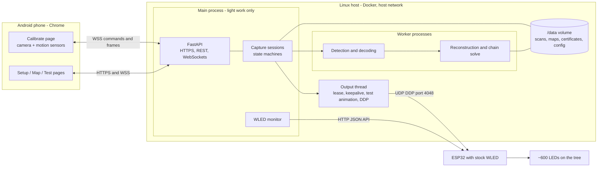
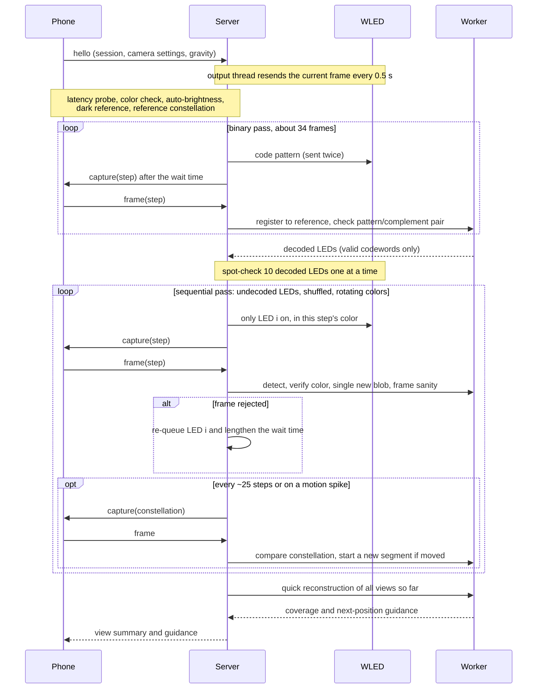

# TreeLights — Architecture

**Status: DRAFT 3 — approved.** Implementation follows the build order in §18.

| Revision | Changes |
|---|---|
| Draft 1 | Initial proposal. |
| Draft 2 | Records your decisions (§1). Adds a failure analysis of draft 1 (§3) and reworks the design to handle each failure. Narrows this build to detection, mapping and one test animation. |
| Draft 3 (approved) | The phone stays on a tripod and the tree is turned between views (§7.1). Chrome's certificate warning is accepted; installing the CA is optional (§6.3). Dynamic `d_max` as in §10.1 confirmed. |

## 1. Decisions

| Topic | Decision |
|---|---|
| Hardware | About 600 LEDs on one ESP32 running stock WLED. One frame is two DDP packets: 480 + 120 LEDs. |
| Distance bound between consecutive LEDs (`d_max`) | **Dynamic.** Learned from the measurements for each link of the chain, not typed in (§10). |
| Reference length | The tree's height, measured from the lowest light to the highest light (§9.10). |
| Phone | Android, using the Chrome browser. No native app. |
| Capture setup | The phone stays fixed on a tripod. The tree is turned between views. |
| HTTPS | Chrome's warning for the server's certificate is acceptable. It appears when the page is opened, never per camera frame. Installing the CA is optional. |
| Host | Linux, Docker with host networking. |
| Stack | Python backend (FastAPI, OpenCV, numpy, scipy). TypeScript + three.js web app. |
| Priority | LED detection and mapping come first, and every part of detection is built. Animations: one test animation only. |

## 2. Goals, scope and principles

**Purpose (unchanged from draft 1):**
- Find the 3D position of every LED on the tree using a phone.
- Drive the LEDs through unmodified WLED, from a Docker container on the LAN.
- Keep the result physically plausible by bounding the distance between consecutive LEDs.
- Produce a map that 3D effects can be built on later.

**Built now:**
- Live capture from Android Chrome, in two modes:
  - **hybrid**: all LEDs blink binary codes at once, then the rest are lit one at a time;
  - **sequential-only**: every LED is lit one at a time.
- Recorded-video capture, as a fallback that doesn't need live camera access in the browser.
- 2D detection, 3D reconstruction, the dynamic chain bound, and filling in LEDs that weren't measured.
- Map review, editing, re-scan, versions, activation, and export (JSON, CSV).
- Optional one-time camera calibration.
- One test animation (a 3D sweep), plus "identify LED" (blink one LED).

**Later.** The map format and the effect interface are designed for these, but they aren't built now:
- falling balls;
- rotation effects that follow the tree's surface;
- drawing from the phone;
- WLED ledmap export;
- multiple controllers.

**Design principles.** Each one answers failures listed in §3.

1. **Verify, don't assume.** Every captured frame must show what we asked for. Nothing relies on a UDP packet having arrived.
2. **Commit late.** Keep several candidate positions per LED until multi-view geometry and the chain bound decide between them.
3. **Isolate the realtime output** from heavy computation.
4. **Keep the raw data and make every stage re-runnable.** Every stage is deterministic, so a re-run gives the same result.
5. **Be honest about what wasn't measured.** Every LED carries a status and an uncertainty. Positions are never invented where there's no evidence.
6. **Never silently replace a working map.**
7. **Solve without absolute scale.** The tree height only converts units.
8. **Survive interruptions:** reconnects, server restarts, a moved phone, a rebooted controller.

## 3. Failure analysis of draft 1

This section lists what would go wrong if draft 1 were built as written, and what this draft changes. Each row points to where the fix lives.

### Output and network

| # | What goes wrong | Effect in draft 1 | Change |
|---|---|---|---|
| F1 | A DDP packet is lost or late over WiFi. UDP has no acknowledgement, and with 600 LEDs one frame is two packets, so half a frame can be lost. | The previous LED stays lit, and its position is silently recorded as the current LED's. Wrong identities are the worst error here because they look like valid data. | Every capture checks itself: a rotating color per step, exactly one new blob of that color, not at a recent LED's position. Frames are sent twice, and the wait time adapts (§7.4, §5.1). |
| F2 | The server pauses for longer than WLED's realtime timeout (2.5 s by default). Causes: CPU busy reconstructing, a stalled upload. | WLED drops back to its own effect mid-scan, and frames fill with unrelated light. | A dedicated output thread resends the current frame every 0.5 s. Heavy work runs in separate processes (§5.4, §6.2). |
| F3 | Something else drives WLED: Home Assistant, the WLED app, a timer, another DDP or E1.31 sender. Or the ESP32 reboots, for example from a power brownout. | The scan is corrupted without notice. | The server watches WLED's realtime source address and uptime, and pauses on any change (§5.3). |
| F4 | WLED's configuration breaks assumptions: wrong LED count, wrong color order, several GPIO outputs, "use main segment only", offsets. | LEDs never light, colors are wrong, or consecutive indices aren't physically next to each other, which breaks the chain bound. | Setup reads WLED's configuration and checks color with the camera. Output boundaries become chain breaks. Index ranges that are never seen get reported, not invented (§5.2, §10.3, §9.9). |
| F5 | WLED settings change after mapping (LED count, outputs, ledmap). | The map silently stops matching the LEDs. | Each map stores a fingerprint of WLED's LED configuration and warns when it no longer matches (§11.4). |
| F6 | DHCP changes the IP address of WLED or of the host. | Output stops, and the HTTPS certificate no longer matches the host. | WLED is identified by its MAC address and found again via mDNS. The server certificate is re-issued automatically (§5.2, §6.3). |
| F7 | The phone's frame uploads and the LED packets share one 2.4 GHz WiFi channel. | Packet loss and latency rise exactly while scanning. | Only one frame is in flight at a time, and frames are kept compact. Setup advises 5 GHz for the phone. F1's checks catch whatever loss remains (§6.1, §7.4). |

### Phone and capture

| # | What goes wrong | Effect in draft 1 | Change |
|---|---|---|---|
| F8 | Self-signed HTTPS. The warning reappears, camera permission may not be remembered, and the certificate breaks when the host IP changes. | The camera page is unusable or annoying every session. | A local certificate authority (CA), optionally installed on the phone once, with server certificates re-issued automatically. A plain-HTTP setup page shows a QR code. Recorded-video mode needs no live camera access (§6.3, §7.7). |
| F9 | The phone moves during a view: a bumped tripod, or hand-held. Draft 1 compared dark frames, which in a dim room have little texture to compare. | Movement is missed, and frames are recorded against the wrong camera pose. | Phone motion sensors give an instant signal, and a constellation of lit LEDs is checked regularly. Movement automatically starts a new camera "segment" and re-captures the affected LEDs (§7.5). |
| F10 | Auto exposure, auto focus or white balance drift. Focus hunting in the dark changes the focal length, and Chrome may switch between the phone's lenses. | Thresholds drift. Draft 1 assumed one shared focal length for all views. | Lock what Chrome exposes, pin the camera, and record settings per view. Focal length is solved per segment, tied to a shared value (§7.2, §9.2). |
| F11 | The screen sleeps, the user switches apps, the phone rotates, or WiFi drops. | Capture stalls or the image rotates mid-view. Draft 1 had no way to resume. | Wake lock and orientation lock. Sessions are resumable step by step, and the constellation is re-checked on resume (§7.2, §7.6). |
| F12 | Someone walks through the frame, or a room light is switched on. | Large changes are taken as LED blobs, or the noise floor rises. | A frame sanity check compares each frame with the dark reference. Failing frames are re-captured after a new reference (§8.1). |
| F13 | Each draft-1 view took 1–1.5 minutes with the phone perfectly still. | More time means more exposure to F1 and F9–F12. | Hybrid mode by default: a binary-coded pass of about 34 frames finds most LEDs at once, and LEDs are lit one at a time only for the rest (§7.3). |
| F14 | The user can't walk all the way round (tree against a wall), or takes views too close together. | Back LEDs are never measured, triangulation is weak, and the user finds out only at the end. | The map is rebuilt after each view, and the phone shows where to stand next. Unseen LEDs are filled using what the cameras could not see, and flagged (§7.8, §9.9). |

### Detection and reconstruction

| # | What goes wrong | Effect in draft 1 | Change |
|---|---|---|---|
| F15 | Reflections in a mirror, window or TV screen agree across views: they triangulate like a real LED behind the glass. | Draft 1 relied on multi-view agreement to reject reflections. | A prior on the tree's volume, the chain bound, and the number of supporting views (§9.5). |
| F16 | Light shining through needles is a diffuse glow, with its center shifted off the LED. | Positions are biased. | The centroid is taken from the bright core only, and sharp observations get more weight (§8.1). |
| F17 | The phone's focal length is unknown, and draft 1 started from one guess. | Reconstruction fails, or settles on a distorted solution. | Multiple starts over several field-of-view guesses. Optional one-time camera calibration with a board shown on any screen (§9.2). |
| F18 | Depth reversal (an "inside-out" tree), or a wrong "up" axis. This is especially likely when views come from one side. | A wrong map that still has good error numbers. | Check that each camera mostly sees LEDs on its own side of the tree. "Up" is decided by agreement of four independent estimates (§9.3, §9.4). |
| F19 | Errors cluster in contiguous index ranges, for example from drift near the end of a view. Draft 1 left the capture order optional. | The chain bound is weakest exactly where errors pile up. | Each view captures LEDs in a shuffled order (§7.4). |
| F20 | Draft 1's parity bits for binary codes miss any two-bit error, so a corrupted code can decode to a wrong but valid index. | Silent wrong identities. | A code where any 1–3 bit errors are always detected and rejected. Complement frames, and a spot-check of decoded LEDs per view (§8.2, §7.3). |

### Chain bound (`d_max`)

| # | What goes wrong | Effect in draft 1 | Change |
|---|---|---|---|
| F21 | One fixed `d_max`. In real strings, link lengths vary, connectors between strands are longer, and separate GPIO outputs aren't connected at all. | Correct long links get "corrected" into wrong positions, or `d_max` is set so large it constrains nothing. | Dynamic per-link bounds learned from the data, with explicit breaks (§10). |
| F22 | A `d_max` in centimeters needs an accurate absolute scale, but tree height is only measured roughly. | Scale error directly loosens or tightens the bound. | The solver is scale-free. Tree height only converts units (§10.1, §9.10). |
| F23 | Measurement uncertainty is ignored. A distant LED with 2 cm uncertainty can "violate" the bound by noise alone. | Good points are rejected. | Each bound includes both LEDs' uncertainty (§10.2). |
| F24 | Long runs of unseen LEDs exceed the gap window. Interpolation can also route through the front of the tree, where LEDs would have been seen. | Draft 1 can't bridge long gaps, and it places filled LEDs in visibly empty places. | Break edges handle gaps of any length. Gaps are filled through places the cameras couldn't see (§9.6, §9.9). |
| F25 | WLED's LED count is larger than the physical string. | Draft 1 had no rule for unseen runs at the ends of the chain, so it would invent positions for LEDs that don't exist. | Unseen runs at either end become `unknown`, with a warning (§9.9). |

### Operations and data

| # | What goes wrong | Effect in draft 1 | Change |
|---|---|---|---|
| F26 | Heavy computation runs in the API process. | Output stalls (see F2). | Separate worker processes (§6.2). |
| F27 | The container restarts mid-scan, or a JSON file is half-written. | A lost or corrupt scan. | Append-only logs, atomic writes, resumable sessions (§13, §7.6). |
| F28 | Raw frames fill the disk: 0.3–0.5 GB per full scan. | The host disk fills up. | Retention policy (§13). |
| F29 | Two phones or pages drive the LEDs at once. | Calibration is corrupted by the test animation or by a second session. | A single output lease with priorities (§5.4). |
| F30 | Draft 1 kept versions, but a worse map could still replace a good one, and coordinates could jump between versions. | Effects break after a re-scan. | Quality gates, explicit activation, and alignment to the previous map (§11.1, §11.2, §9.10). |
| F31 | The tree changes over days: branches sag, or the tree gets bumped. | The map slowly goes wrong. | Quick partial re-scan, merged into a new version (§11.5). |

### Residual risks of this design

These are the risks this draft adds or can't fully remove, and how each one is limited:
- **Color verification depends on the camera telling colors apart.** The color check measures this per view. If colors can't be told apart, the position-based stale check still applies (§7.4).
- **The binary pass adds decoding complexity.** A spot-check per view drops back to sequential-only on any doubt.
- **The local CA is a trust anchor on the phone.** Installing it is optional, it is restricted to private LAN addresses where the phone honors that, and its key stays in `/data`.
- **Automatic segmenting could produce many tiny segments with a shaky phone.** Frequent movement pauses the scan and asks for a stand.
- **The visibility model used for gap filling is rough.** It only chooses the direction around the tree, and the result is always labelled `estimated`.
- **The tree-volume prior could penalize a real LED on a far-reaching branch.** It is soft and generous, never a hard cut.

## 4. System overview



One container runs three kinds of work, kept apart:
- **Main process.** Light work only: the API, capture sessions and WLED monitoring.
- **Output thread.** The only code that sends LED data. It never waits on anything else.
- **Worker processes.** All heavy computation.

Whenever the server stops sending, WLED returns to its own effects, so a crash never leaves the tree dark.

## 5. WLED output

### 5.1 Protocols

| Purpose | Mechanism |
|---|---|
| LED colors | **DDP** over UDP port 4048. 600 RGB LEDs are 1800 bytes, sent as two packets: 480 pixels at offset 0, and 120 pixels at byte offset 1440. The second packet carries the PUSH flag. |
| Fallback | WLED's UDP realtime **DNRGB** protocol (port 21324). It can be selected if DDP misbehaves on some firmware version. |
| Info, config, state | JSON API: `/json/info`, `/json/cfg`, `/json/state`. |
| Discovery | mDNS `_wled._tcp`. |

- **Calibration frames are sent twice**, a few milliseconds apart. Re-sending the same frame is harmless.
- **The test animation runs at 40 fps.** 600 WS281x LEDs take about 18 ms to receive their data, so about 55 fps is the hardware ceiling.

### 5.2 Discovery, identity and setup checks

- **Identity.** A controller is identified by its MAC address from `/json/info`, not by its IP. If the IP stops answering, the server rediscovers controllers via mDNS and matches the MAC.
- **Setup checks**, shown as a checklist:
  - Firmware version (warn below 0.14), LED count, and the configured current limit.
  - From `/json/cfg`, when readable: LED outputs (start and length per GPIO pin), color order, skipped or reversed LEDs, and realtime settings. Output boundaries become chain breaks (§10.3). Key names vary between WLED versions; a missing key shows as "unknown", never as an error.
  - **Realtime check:** send a DDP frame, then confirm that `/json/info` reports realtime mode from this server's IP.
  - **Index chase:** one lit LED runs along the whole string, and you confirm it reaches the end. This catches a wrong LED count or a limited realtime range.
- **Color order** is confirmed by the camera at the start of every view (§7.3).

### 5.3 Monitoring during sessions

While the server holds the output, it polls `/json/info` about every 3 s:
- **Realtime source isn't this server.** Something else is sending, so pause and tell the user.
- **Uptime went down.** The controller rebooted, often from a power problem. Pause, and re-capture the frames taken since the last good check.
- **Unreachable.** Pause and rediscover (§5.2).

### 5.4 Output lease and keepalive

- **One owner at a time,** in priority order: calibration > identify LED > test animation > nobody. A second client asking for the output is told it's busy.
- **The lease is tied to the client's WebSocket heartbeat.** If the client disappears, the lease ends.
- **Keepalive.** While a client holds the lease, the output thread resends the current frame every 0.5 s, whatever else is happening.
- **Nobody holding the lease:** the server stops sending, and WLED returns to its own effects after its timeout.
- **Restoring WLED state.** If calibration temporarily changes WLED state (for example master brightness, §7.3), the original state is saved to disk first. It is restored at the end, or at the next start-up after a crash.

## 6. Deployment and runtime

### 6.1 Container and network

- **One image:**
  - built in two stages: Node builds the web app, then a `python:3.12-slim` runtime;
  - runtime libraries: FastAPI/uvicorn, numpy, scipy, opencv-python-headless, zeroconf, PyAV (video decoding) and cryptography;
  - dependencies pinned in a lock file;
  - images for amd64 and arm64 (for example a Raspberry Pi 4 or 5).
- **docker-compose:**
  - `network_mode: host`, needed for mDNS discovery;
  - `restart: unless-stopped` and a healthcheck;
  - volume `./data:/data`;
  - runs as a non-root user.
- **Ports.** 8443 serves HTTPS (app, API, WebSockets). 8080 serves plain HTTP for the setup page only (§6.3). The host firewall must allow both from the LAN.
- **Network advice, shown in Setup:**
  - The phone must reach the host directly: no guest network and no client isolation.
  - If the router offers 5 GHz, put the phone on it. The ESP32 only uses 2.4 GHz, so the phone's uploads then don't compete with the LED packets.

### 6.2 Process model

- **Main process (asyncio):** the HTTP and WebSocket API, the capture session state machines, and the WLED monitor. Light work only.
- **Output thread:** the DDP sender, the keepalive and the test animation renderer. Rendering 600 LEDs with numpy is trivial. Its timing never depends on the event loop.
- **Worker processes (pool):** image and video decoding, detection, binary decoding and reconstruction. Frames are passed as file paths, and results come back as small messages.
- **A reconstruction can take seconds to a minute,** but it can never delay a DDP packet.

### 6.3 HTTPS and first-time phone setup

Chrome only allows camera access on secure (HTTPS) pages. The setup works like this:

1. **Certificates.**
   - On first start, the container creates a **local certificate authority (CA)** and stores it in `/data`.
   - The CA issues the server's certificate, covering the host's current LAN IPs and hostname.
   - If the host's address changes, a new server certificate is issued automatically at start-up. Nothing needs redoing on the phone.
2. **Setup page.** `http://<host>:8080` is a plain-HTTP setup page, also printed as a QR code in the container log. It offers:
   - the CA certificate to download, with install instructions. On Android: Settings → Security → Encryption & credentials → Install a certificate → CA certificate; the wording varies by Android version.
   - a link to the HTTPS app.
3. **Default: tap through Chrome's warning.** It appears when the page is opened (Chrome remembers the decision for a while), never per camera frame: frames travel over the page's single WebSocket connection, which Chrome lets through once the warning was accepted for that address.
   - Installing the CA is optional. It removes the warning and lets Chrome remember the camera permission.
   - Both paths get tested on your phone in build step 1.
4. **Limiting the CA's power.** The CA carries X.509 name constraints that limit it to private LAN address ranges and the host name, wherever the phone's certificate verifier honors them. Its private key never leaves `/data`.
5. **Fallback.** If live camera access fails entirely, recorded-video mode (§7.7) needs only a file upload.

### 6.4 Security

- LAN only. Nothing is exposed to the internet.
- Optional PIN for the control pages and the output.
- Upload size limits. Uploaded files are only parsed by decoders in the worker processes.

## 7. Capture

### 7.1 User flow

1. **Setup:** pick the WLED controller, run the checks, enter the tree height.
2. **Camera calibration** (optional, once per phone, §9.2).
3. **Calibrate.** The phone stays on a tripod, aimed at the tree, for the whole scan. For each view:
   1. Turn the tree by the angle the app suggests (about 45°), then step out of the picture.
   2. Start the view. Touching the tripod-mounted phone can shake it, so the view can be started from any other browser (laptop or second phone) on the **Control** panel, or from the tripod phone with a 5 s countdown.
   3. The server waits until the scene has settled (§7.5), then captures for about 30–60 s.
   4. Repeat until coverage is good: typically 8 views (one full turn), and at least 4 are required.

   For the reconstruction, turning the tree in front of a fixed camera is the same as moving the camera around a fixed tree: only LED positions relative to the tree are used. It has two extra benefits:
   - Reflections in mirrors, windows and screens stay fixed relative to the camera while the tree turns, so they don't line up across views in the tree's frame and are rejected by the geometry.
   - Every view is a rotation about the same vertical axis, which gives a strong estimate of "up" and of the tree's axis (§9.4).
4. **Solve:**
   - Review the 3D map and its quality report.
   - Run the sweep test on the real tree.
   - Activate the map.

**Terminology:**
- A **view** is one placement of the phone.
- If the phone moves during a view, the view is split into **segments**.
- Each segment is a separate camera in the reconstruction.

### 7.2 Camera setup on the phone

- **Camera choice.** You pick a back camera from the list Chrome reports. Its device ID is pinned for the whole scan, because phones with several lenses can otherwise switch between them. Zoom is fixed at 1×.
- **Resolution.** Request 1920×1080, falling back to 1280×720. The actual settings are recorded per segment.
- **Locks.** Where Chrome offers them (`getCapabilities()`):
  - manual exposure (exposure time and ISO);
  - manual focus, set with the LEDs on and then locked;
  - manual white balance.

  What could and couldn't be locked is recorded and shown. Without locks, capture still works but relies more on frequent dark references (§7.3) and per-segment focal lengths (§9.2).
- **Fullscreen with orientation lock.** Chrome only allows orientation lock in fullscreen. A screen wake lock keeps the screen on.
- **Motion sensors** (`DeviceMotionEvent`; Android doesn't ask permission):
  - the averaged gravity vector per segment, used for the "up" axis (§9.4);
  - spikes in rotation rate, used as an instant "phone bumped" signal (§7.5).
- **Frame grabbing.** Frames are grabbed with `requestVideoFrameCallback`, so each capture uses a frame displayed after the requested wait time. Frames are sent as JPEG at quality of about 0.9.

### 7.3 Capture plan for one view

**Hybrid (the default):**

1. **Latency probe.**
   - All LEDs blink dimly 5 times, and the phone timestamps when image brightness changes.
   - The initial wait time is the 95th percentile of that delay plus one frame interval.
   - It adapts during the scan (§7.4).
2. **Color check.**
   - About 20 LEDs spread along the string are lit red, then green, then blue.
   - This learns how each commanded color looks to this camera.
   - It also detects a wrong color order configured in WLED; the app warns and compensates.
3. **Auto-brightness.**
   - Using the same LEDs, find the level where typical LEDs are bright but not saturated.
   - If WLED's master brightness keeps it too low, the server can raise it temporarily. The old value is saved and restored (§5.4).
4. **Dark reference.**
   - 5 dark frames, combined by median.
   - Plus the **reference constellation**: about 20 LEDs, spread by index, lit together. It's used for movement checks (§7.5).
5. **Binary pass** (about 34 frames).
   - 2 frames with all LEDs on, as a reference image.
   - Then 16 code bits, each shown as a pattern frame and its complement: 32 frames.
   - Each LED blinks its own index as a 16-bit codeword (§8.2).
6. **Spot-check.**
   - 10 randomly chosen decoded LEDs are lit one at a time, and each must appear where it was decoded.
   - A single mismatch throws away this view's binary results, and the view becomes sequential-only.
7. **Sequential pass.**
   - LEDs not decoded are lit one at a time, in shuffled order, with rotating colors (§7.4).
   - By default, only LEDs that are probably visible from this view are tried: those in a short undecoded run (8 or fewer) between decoded neighbours, or those the live reconstruction predicts are visible (§7.8).
   - A "thorough" switch tries every undecoded LED.
8. **Retries.**
   - LEDs with rejected frames or ambiguous results are captured up to 2 more times.
   - Only candidates that repeat within about 2 px are kept.

Throughout the view, the reference constellation is re-checked every ~25 frames, after any motion spike, and at the end.

**Sequential-only:** steps 1–4, then step 7 for all LEDs, then step 8.
- About 2 minutes per view.
- No decoding step at all.
- Used automatically when a spot-check fails.

**Time:** hybrid takes about 30–60 s per view, so 6–8 views take about 5–8 minutes.



### 7.4 Per-frame verification

This applies to sequential and spot-check frames. A frame for "LED *i*, step *k*" is accepted only if all of these hold:

- **Exactly one new strong blob** compared with the dark reference. Weaker reflection candidates are allowed alongside it.
- **The expected color.** Step *k* uses a color that cycles red → green → blue. A stale frame (lost packet, slow camera) shows the previous LED in the previous color, so it is rejected.
- **Not where a recent LED was.** The blob must not sit where blobs from the previous 2 steps were. The order is shuffled, so consecutive LEDs are rarely near each other in the image. This catches stale frames even when colors are hard to tell apart.
- **Frame sanity** (§8.1): the rest of the image matches the dark reference within noise.

When a frame is rejected:
1. The LED is re-queued.
2. The wait time grows by 30%. It shrinks back by 5% after every 50 clean steps.
3. Repeated rejections trigger a new dark reference.
4. If rejections persist, capture pauses and shows the reason.

**Other transport measures:**
- **Stop-and-wait.** Only one frame is in flight at a time. The server lights the next LED as soon as a frame has arrived, while detection of that frame runs in a worker.
- **Duplicate sends.** Calibration DDP frames are sent twice.
- **Shuffled order** per view, with a fixed seed. Errors from drift or interruptions then land on scattered indices instead of a contiguous run, so the chain bound can catch them.

### 7.5 Movement detection and segments

- **Movement signals:**
  - a rotation-rate spike from the phone's sensors;
  - a reference-constellation check every ~25 frames. The two blob sets are matched; if the best similarity transform leaves a median residual over about 1.5 px, the phone has moved;
  - in the binary pass, each frame's registration to the reference (§8.2).
- **On movement:**
  - frames taken since the last good check are discarded;
  - a new segment starts with a fresh dark reference and constellation;
  - the discarded LEDs are re-queued.

  No user decision is needed.
- **Frequent movement** (for example more than 3 times in 2 minutes) pauses capture and asks for a stable stand.
- **A bump to the tree** rather than the phone looks the same, and is handled the same way.
- **Settling after a turn.** A freshly turned tree keeps swaying, and the person who turned it may still be in the picture. Before a view starts, the server captures the reference constellation repeatedly, about 1 s apart, until two in a row match within ~1 px and a fresh dark frame passes the sanity check (§8.1). Only then do the dark reference and capture begin. If it doesn't settle within 30 s, the phone says why.

### 7.6 Session protocol and resume

- **The server is in charge.**
  - It runs one state machine per view and sends `capture(step_id, kind)`.
  - The phone answers each request with exactly one frame tagged with that step ID.
  - Frames with an unexpected step ID are dropped.
- **Heartbeat** every 1 s. After 5 s of silence (screen off, app switched, WiFi drop), capture pauses, the LEDs turn off, and the session state is kept.
- **Resume:**
  1. The phone reconnects with its session ID.
  2. The server takes a new dark reference and constellation.
  3. If the constellation matches, the segment continues; otherwise a new segment starts.
- **Server restart.** Every event is appended to a log on disk, so after a restart the session is rebuilt from the log and can resume.

### 7.7 Recorded-video mode

This mode is for when live camera access isn't possible. It also lets you use the phone's own camera app, with manual ("Pro") exposure and focus.

- **The page offers "Play sequence" and a file upload.** On Android, `<input type="file" accept="video/*" capture>` opens the camera recorder directly.
- **The sequence the LEDs play:**
  1. A repeating "ready" pulse, until you tap Play.
  2. A sync preamble of distinctive whole-tree flashes.
  3. Blocks of 50 LEDs: each LED lit for about 0.2 s, in rotating colors and shuffled order. Each block starts with a constellation flash and its block number flashed in binary.
  4. An end marker.
- **Decoding** (in a worker, with PyAV/FFmpeg, using frame timestamps):
  1. Find the flashes in the overall brightness of the video.
  2. Fit the mapping from video time to sequence time separately per block. This copes with dropped frames and variable frame rates.
  3. Register each block's constellation; movement starts a new segment.
  4. Sample the middle frames of each LED's window.
  5. Run the same detector and verification as live mode.
- **LEDs that failed** are listed for a live re-scan or another recording.
- **About 3 minutes per view.** There's no feedback while recording, so this is the fallback rather than the default.

### 7.8 Live reconstruction and coverage guidance

After each view, a worker quickly rebuilds the map from everything captured so far. The phone shows:
- which views are registered, and how many LEDs have been measured from 2 or more views;
- a top-down sketch of the tree with the directions it has been viewed from;
- **how far to turn the tree next:** towards the largest gap in viewing directions, weighted by where the unmeasured LEDs are.

The quick reconstruction also predicts which LEDs face the next view, which focuses that view's sequential pass (§7.3).

## 8. 2D detection and decoding

### 8.1 Single-LED frames

1. **Difference.** Take the signed difference to the dark reference, per color channel.
2. **Noise and threshold.** Estimate each channel's noise robustly from the median absolute deviation. The threshold is about 6–8 × that noise, with an absolute floor.
3. **Expected color.** Project the difference onto the expected color learned in the color check. The off-color part is kept for verification.
4. **Peak finding.** Find local maxima with a minimum separation, rather than plain connected regions, so an LED and a nearby reflection stay separate.
5. **Core-only centroid.** Compute the sub-pixel centroid from pixels above 50% of the peak, in a small window. Glow through needles is lopsided; using only the core stops it from pulling the position.
6. **Candidates.**
   - Each peak is measured for SNR, sharpness (peak relative to area), saturation and color match.
   - Up to 3 candidates are kept per frame, each with a score.
   - Diffuse or very large blobs score low.
7. **Frame sanity.** Outside the candidate regions, the difference must look like noise. A large changed region (person walking past, light switched on, exposure jump) invalidates the frame. That triggers a new dark reference and a recapture.
8. **Output.** For each (segment, LED) pair, the detector reports its candidates, or "not seen in a valid frame". The second is negative information, used when filling gaps (§9.9).

### 8.2 Binary-coded frames

- **Code.** Each LED index is encoded as an extended Hamming(16,11) codeword.
  - 11 data bits cover up to 2048 LEDs.
  - Any two codewords differ in at least 4 bits, so 1–3 bit errors always produce an invalid word.
  - Invalid words are rejected, never corrected into a possibly wrong index.
- **Complement frames.** Each bit is shown as a pattern frame and its complement, so every LED is lit in exactly one frame of each pair. A bit is decided by comparing that LED's own brightness in the two frames, not by a global threshold.
- **Peaks** are found in the all-on reference image. Peak finding separates neighbouring LEDs.
- **Registration.** Each frame is registered to the reference, using phase correlation of dark-subtracted images. A shift over 3 px, or a weak correlation, means a recapture. This also tolerates small hand shake.
- **Bit reliability.** For each peak and bit: reliability = |pattern − complement| / (pattern + complement). Any unreliable bit rejects that peak. Two LEDs merged into one peak give unreliable bits, so they're rejected this way.
- **Pair consistency.** In each pattern/complement pair, most peaks must be lit in exactly one of the two frames. Otherwise the pair was stale or caught mid-change (rolling shutter), and it is recaptured.
- **Candidates.** A peak that decodes to index *i* becomes a candidate for LED *i*. A reflection decodes to the same index and simply becomes another candidate.

## 9. Reconstruction

### 9.1 Inputs

- **Per segment:** image size, camera settings, gravity vector.
- **Per LED in each segment:** up to 3 candidates (x, y, score), or "not seen".
- **The scan's overrides** (your edits, §11.3).

Random seeds are fixed, so the same scan always produces the same map.

### 9.2 Camera model and intrinsics

- **Model:** pinhole, with the principal point at the image center. Radial distortion (k1 and k2) is shared by all segments.
- **Focal length per segment.** A prior (about 2%) ties each segment's focal length to a shared value. This absorbs focus breathing or a lens switch, which draft 1's single focal length couldn't.
- **Focal lengths are expressed relative to the longer image side.** Portrait and landscape segments, and different resolutions, are then comparable.
- **Starting focal length:**
  - from the optional camera calibration, if done;
  - otherwise, several starts at 55°, 65°, 75° and 85° horizontal field of view, keeping the best solution.
- **Optional camera calibration** (once per phone and resolution):
  - The Setup page shows a ChArUco board full-screen on any computer monitor.
  - The phone captures about 15 images of it from different angles.
  - OpenCV computes focal length and distortion, which are used as a strong prior.

### 9.3 Camera poses and ambiguity checks

1. **Only unambiguous observations** (a single strong candidate) are used to estimate cameras, so reflections can't influence them.
2. **Seed pair.**
   - Pick the two segments with the most shared LEDs and a good angle between them (median triangulation angle of about 5° or more).
   - Estimate their relative pose (essential matrix with RANSAC) and triangulate the shared LEDs.
3. **Add the other segments one at a time.**
   - Find each segment's pose with PnP + RANSAC, then triangulate the LEDs it newly adds.
   - After each addition, run bundle adjustment with a robust (Cauchy) loss.
4. **Multiple starts:** focal-length guesses × the top 3 seed pairs. Keep the solution with the lowest robust error per observation and the most registered segments.
5. **Checks:**
   - **In front:** every point must be in front of the cameras that see it.
   - **Visibility side:** each camera should mostly see LEDs on its own side of the tree. A depth-reversed ("inside-out") solution fails this.
   - If a check fails, the next-best start is tried. If all of them fail, the report says so.

### 9.4 World orientation

**Up axis.** Decided by agreement between independent estimates:
- **the turning axis:** the tree is turned about a vertical axis, so the relative rotations between views all share one axis. This is the strongest estimate;
- the phone's gravity vector, rotated into the tree's frame by each camera's pose;
- the average camera "up" direction, since a tripod-mounted phone is roughly upright;
- the normal of the plane through the camera positions, which lie on a circle around the tree;
- the long axis of the point cloud.

The largest group agreeing within about 15° wins, and any disagreement is reported. The Map page has a one-tap fix.

**Tree axis.** The turning axis, where the camera poses give it clearly. Otherwise a vertical line fitted jointly over all heights as the center of a cone through the outer LEDs.

Both are provisional at this stage and finalised in §9.10.

### 9.5 Per-LED hypotheses and tree-volume prior

**Hypotheses.** Each LED gets up to 5 hypotheses:
1. Run RANSAC over pairs of candidates from different segments, and triangulate each pair.
2. Collect inliers: at most one candidate per segment, reprojection error under about 3 px, and in front of the camera.
3. Refine each hypothesis, and merge duplicates.
4. Keep up to 5. Each records its position, supporting segments, reprojection error, triangulation angle and uncertainty.

**Tree-volume prior.**
- A generous envelope of the tree is built from the most reliable hypotheses: the radius profile × about 1.3, and the height range + 10%.
- Hypotheses outside it get a cost that grows with distance.
- This handles reflections that survive the geometry checks. With the tree turned in front of a fixed camera, most reflections don't line up across views anyway (§7.1).
- It is soft, never a hard cut.

LEDs seen in only one segment get no hypotheses here; §9.9 places them.

### 9.6 Chain selection

This step picks at most one hypothesis per LED, so that the whole chain respects the per-link bounds from §10. It is solved exactly as a shortest path through a directed acyclic graph:

- **Nodes** are (LED *i*, hypothesis *h*). A node's cost comes from reprojection error, the number of supporting segments, the triangulation angle, candidate scores and the tree-volume prior.
- **Normal edges** go from (*i*, *h*) to (*j*, *h'*) for 1 ≤ *j* − *i* ≤ 20.
  - An edge is allowed only if the distance between the two hypotheses fits within the sum of the bounds of links *i* … *j* − 1.
  - Each skipped LED costs `c_miss`.
- **Break edges** allow a jump of any distance, at cost `c_break` plus the skipped LEDs.
  - They bridge long unseen runs, which draft 1 couldn't do.
  - At a real break (§10.3), a break edge costs nothing.
- **Cost.** O(N · 20 · H²), plus a running minimum for break edges: milliseconds for 600 LEDs.
- **Why it rejects outliers.** An isolated wrong hypothesis loses, because it would need impossible jumps on both sides.

### 9.7 Joint refinement and uncertainty

- **Joint least squares** over the selected points, the cameras and the intrinsics. It combines robust reprojection terms with a penalty for any link that exceeds its bound.
- **Per-LED uncertainty** is computed from the local geometry (a 3×3 covariance with the cameras fixed) and stored as a radius. It feeds the bound checks (§10.2) and the map.

### 9.8 Surface model

- **Radius profile r_s(h):**
  - in height bands, take about the 90th percentile of the measured LEDs' distances from the axis;
  - smooth the result;
  - force it to be non-increasing towards the top.
- **Per-LED features:**
  - cylindrical coordinates (h, θ, r);
  - normalised height;
  - depth within the tree, r / r_s(h);
  - position along the chain, as a fraction.

### 9.9 Filling what wasn't measured

- **LEDs seen in only one segment.**
  - Placed on their viewing ray, at the depth that best fits their neighbours and bounds.
  - If there are several candidates, the one whose ray fits best is chosen.
  - Status: `single_view`.
- **Gaps between measured LEDs.** A small least-squares solve per gap. It uses:
  - the link bounds;
  - ray constraints for any single-segment LEDs inside the gap;
  - a weak pull towards a path along the surface, interpolating h, θ and r / r_s.

  The path goes round the tree in whichever direction (clockwise or anticlockwise) passes through places the cameras could **not** see, since an LED in a well-observed spot would have been detected. Status: `estimated`, with uncertainty growing towards the middle of the gap.
- **Unseen runs at either end of the chain.** With a measured neighbour on only one side, they can't be bounded. They get status `unknown`, no position, and a warning. This often means WLED's LED count is larger than the string.

### 9.10 Scale, origin and frame continuity

- **Scale** = tree height ÷ the vertical distance between the lowest and highest measured LEDs. No earlier step depends on it.
- **Origin** is on the tree axis, at the height of the lowest LED.
- **Axes:** y points up, and +z points towards the first view.
- **Frame continuity.** If an active map exists, the new map is rotated about the vertical axis and shifted to line up with it, using the LEDs measured well in both. Coordinates then don't jump between versions.

### 9.11 Quality report

- **Per LED:** status, segments, reprojection error, uncertainty, and any bound violations.
- **Overall:**
  - registered segments and the focal length estimate;
  - median reprojection error;
  - share of LEDs in each status;
  - up-axis agreement and the visibility-side check;
  - learned base link length, long links and breaks;
  - index ranges that were never seen.

## 10. Dynamic chain bound (`d_max`)

### 10.1 What "dynamic" means here

- **Not typed in.** It is learned from the measured map, separately for each link.
- **Scale-free.** It is learned in reconstruction units and only reported in cm, via the tree height.
- **Varies along the chain:**
  - normal links;
  - longer connector links between strands;
  - breaks between WLED outputs.
- **Re-learned on every solve,** in alternation with chain selection.
- **Overridable.** You can still override any link, or set a global cap.

### 10.2 Learning the bounds

1. **Trusted links.** Consecutive LEDs that both have a dominant hypothesis, seen by 3 or more segments with low error.
2. **Base length L.** The upper edge of the bulk of trusted-link lengths: about the 95th percentile, after removing gross outliers. Wires drape, so many links are shorter than the wire, and the upper edge approximates the wire length.
3. **Per-link bound.** b_i = L·(1 + margin) + 2·√(σ_i² + σ_{i+1}²). This includes both LEDs' uncertainty, so noisy far-away LEDs aren't rejected.
4. **Long links.**
   - A trusted link longer than the normal bound, but no more than 3·L, is a connector between strands. Its bound becomes its measured length plus a margin.
   - If long links repeat at a regular index interval (for example every 50 LEDs), the same interval is predicted where it couldn't be measured.
5. **Untrusted links** use the normal bound.

### 10.3 Breaks (no bound)

- Boundaries between WLED outputs, read from `/json/cfg`.
- Trusted links longer than 3·L.
- Links you mark as breaks on the Map page.

### 10.4 Iteration and safeguards

- **Iteration.** The cycle is: hypotheses → bounds → chain selection → refinement → re-learn the bounds. It repeats until the set of long links and breaks stops changing, for at most 3 rounds.
- **Too few trusted links** (fewer than 30): a wide fallback bound, set as a fraction of the tree height, and a warning.
- **A bound never drops below a trusted link's measured length.**
- **Visible and editable.** The Map page lists the learned base length (in cm), the long links and the breaks, and all of them can be edited.

## 11. Map lifecycle

### 11.1 Versions and activation

Every solve writes a new, immutable map version. Nothing changes on the tree until you activate a version, and the previous one stays one tap away.

### 11.2 Quality gates

- **Hard (activation is blocked):**
  - fewer than 3 registered segments;
  - bundle adjustment failed.
- **Warnings:**
  - fewer than 70% of LEDs measured;
  - median reprojection error over 2 px;
  - up-axis disagreement;
  - a failed visibility-side check;
  - index ranges never seen;
  - many breaks.

### 11.3 Review and editing

- **3D viewer** (three.js): LEDs colored by status, the chain drawn as a line, and long links and breaks highlighted.
- **Tap an LED** to make it blink on the real tree and to see its details.
- **Edits:**
  - mark an LED bad;
  - move it (drag in a plane facing the viewer);
  - lock it;
  - mark or unmark a break;
  - edit a link's bound.
- **Edits are kept** as scan overrides, re-applied by every later solve, so they're never lost.

### 11.4 WLED fingerprint

Each map stores the controller's MAC address and a hash of its LED-output and realtime configuration. The fingerprint is checked at start-up and before activation. A mismatch shows a warning.

### 11.5 Re-scan and maintenance

1. Select LEDs to re-scan, or choose "all low-confidence".
2. A short capture covers those LEDs plus about 40 well-measured LEDs spread across the image, so the new segment can be registered.
3. The result is merged with the existing scan into a new map version.

Use the same flow when the tree has settled or been bumped.

## 12. Test animation and output safety

- **One test animation: the sweep test.**
  - A horizontal plane rises up the tree.
  - A vertical half-plane rotates around the axis.
  - A sphere grows from the center.
  - It loops.
- **"Status colors" option:**
  - `measured` LEDs green, `single_view` yellow, `estimated` orange, `unknown` off;
  - shows on the real tree where the map is weak.
- **Identify:** blink one chosen LED.
- **Before any map exists:** an index chase along the string instead.
- **Rendering:** 40 fps in the output thread.
- **Effect interface** (`TreeGeometry`, and `Effect.render(t, dt, out)`). It is defined now so that later effects plug in without changing the architecture.
- **Power cap.**
  - Each frame's current draw is estimated from its RGB values, using a configurable mA per channel.
  - Brightness is scaled down to stay within WLED's configured limit (from `/json/info`), or a limit set in Setup.

## 13. Storage

```
/data/
  config.json
  tls/                       local CA and server certificate
  wled_restore.json          WLED state saved while calibration changes it
  scans/<scan>/
    scan.json                settings, segments, camera info
    events.jsonl             append-only session log
    detections.jsonl         append-only per-frame results
    overrides.json           your edits (§11.3)
    frames/<segment>/*.jpg   raw frames
  maps/<map>/map.json        immutable versions
  maps/active                pointer to the active version
```

- **Crash safety.**
  - JSON files are written atomically (temp file, fsync, rename), and logs are append-only.
  - A crash loses at most the frame being written.
- **Retention.**
  - Raw frames are kept for the active map's scan and the 2 most recent scans (configurable).
  - Detections are small and kept forever.
  - A full scan's frames take about 0.3–0.5 GB.
- **Reproducibility.** Each map records its inputs: the scan, overrides, parameters and software version.

## 14. Map file format

`/data/maps/<map>/map.json`:

```json
{
  "format": 2,
  "id": "2026-12-01T19-30-00",
  "scan": "2026-12-01T18-55-12",
  "software": "0.1.0",
  "units": "cm",
  "tree_height": 180.0,
  "frame": { "up": "+y", "front": "+z", "origin": "axis_at_lowest_led" },
  "wled": { "mac": "aabbccddeeff", "led_count": 600, "config_hash": "sha256:3f2a..." },
  "chain": {
    "base_link": 9.6,
    "long_links": [{ "from": 49, "bound": 21.0 }],
    "breaks": [{ "from": 299, "reason": "wled_output_boundary" }]
  },
  "surface": { "h": [0, 10, 20], "r": [62.0, 59.5, 56.0] },
  "cameras": [
    { "segment": "v1a", "size": [1920, 1080], "f": 1480.0, "k": [-0.03, 0.01],
      "R": [[1, 0, 0], [0, 1, 0], [0, 0, 1]], "t": [0, 0, 250] }
  ],
  "leds": [
    { "i": 0,   "p": [12.1, 3.4, -40.2], "status": "measured",    "segments": 4, "err_px": 0.8,  "sigma": 0.4 },
    { "i": 1,   "p": [14.0, 4.1, -38.9], "status": "single_view", "segments": 1, "err_px": 0.6,  "sigma": 3.0 },
    { "i": 2,   "p": [15.2, 5.0, -37.5], "status": "estimated",   "segments": 0, "err_px": null, "sigma": 6.0 },
    { "i": 599, "p": null,               "status": "unknown",     "segments": 0, "err_px": null, "sigma": null }
  ],
  "quality": { "median_err_px": 0.9, "measured": 0.86, "single_view": 0.06, "estimated": 0.07, "unknown": 0.01, "warnings": [] }
}
```

- **Status values:** `measured`, `single_view`, `estimated`, `unknown`, and `manual` (placed by you).
- **`sigma`** is the uncertainty radius, in map units.
- **Exports:** this JSON, and CSV (`i, x, y, z, status, sigma`).

## 15. Web app

The web app is phone-first, built with TypeScript, Vite and three.js, and served by the container.

| Page | Purpose |
|---|---|
| Setup | Controller discovery and checks, tree height, network and HTTPS help, power limit. |
| Calibrate | Runs on the tripod phone: camera setup, capture progress, live detection overlay, warnings, coverage guidance, video upload. |
| Control | Runs on any other browser: start the next view, see progress and "turn the tree by N°" guidance without touching the tripod phone. |
| Camera calibration | Optional: the ChArUco board, shown on a monitor, and the capture, done on the phone. |
| Map | 3D review, quality report, editing, re-scan, versions, activation, export. |
| Test | Sweep test, status colors, identify LED, brightness. |

## 16. Server layout and API

```
server/treelights/
  app.py             FastAPI app, routes, static files
  config.py          settings (/data/config.json)
  storage/           atomic writes, append-only logs, retention
  tls/               local CA, certificates, setup page
  wled/              DDP, JSON API client, discovery, monitor, config fingerprint
  output/            lease, output thread, keepalive, renderer, power cap
  capture/           session state machines, protocol, capture plans, codes, verification
  detection/         detector, binary decoder, registration, sanity checks, video decoding
  reconstruction/    camera model, poses, bundle adjustment, orientation, hypotheses,
                     chain selection, bounds, refinement, surface, filling, quality
  maps/              map model, versions, overrides, alignment, export
  effects/           TreeGeometry, effect interface, sweep test
  workers.py         process pool and job queue
web/                 Vite + TypeScript + three.js
tools/sim/           synthetic tree, virtual WLED, virtual phone, fault scenarios
tests/
docker/              Dockerfile, docker-compose.yml
```

**API (sketch):**

- **Config:** `GET`/`PUT /api/config`
- **WLED:** `GET /api/wled/discover`, `GET /api/wled/checks`, `POST /api/wled/identify {index}`
- **Output lease:** `POST`/`DELETE /api/output/lease`. The lease is also kept by the WebSocket heartbeat.
- **Scans:** `POST /api/scans`, `GET /api/scans/{scan}`, `GET /api/scans/{scan}/coverage`, `PUT /api/scans/{scan}/overrides`
- **Live capture:** `WSS /ws/capture`, the protocol in §7.6. Frames travel as binary messages.
- **Video:** `POST /api/scans/{scan}/sequence/play`, and `POST /api/scans/{scan}/videos` (resumable upload)
- **Solving:** `POST /api/scans/{scan}/solve` returns a job; `GET /api/jobs/{job}`
- **Maps:** `GET /api/maps`, `GET /api/maps/{map}`, `POST /api/maps/{map}/activate`, `GET /api/maps/{map}/export?fmt=json|csv`
- **Test animation:** `POST /api/test/start`, `POST /api/test/stop`, and `WSS /ws/preview` (live colors for the 3D view)
- **Camera calibration:** `POST /api/camera-profiles`

## 17. Testing

**Closed-loop simulator.** It is built before detection, and every later step is tested against it. It has three parts:
- **Synthetic tree:** a cone with branches that block views, and a chain made of strands joined by connector links, with an optional second output. One side can be placed against a wall.
- **Virtual WLED:** speaks real DDP and a real JSON API on localhost, and keeps the LED state.
- **Virtual phone:** renders frames from the LED state and a camera pose, and talks the real WebSocket protocol.

**Fault injection:**
- **Network:** packet loss up to 5%, latency spikes, reordering.
- **Controller:** a reboot, a second sender.
- **Camera:** a bump, slow drift, exposure jumps, focus breathing.
- **Scene:** a person walking past, a room light switching on, mirror reflections, glossy ornaments, TV flicker, diffuse glow through needles.
- **Setup:** an LED count larger than the string, views from one side only.
- **Interruptions:** phone disconnects, a server restart mid-scan.

**Acceptance targets on the default fault scenario:**
- Zero LEDs assigned another LED's position.
- For measured LEDs, median position error under 1% of the tree height, and the 95th percentile under 3%.
- Learned base link length within 10% of the truth.
- Every true break and connector found.
- Re-running a solve gives an identical map.

**Unit tests:** DDP encoding, the Hamming code, the detector on recorded frames, chain selection on hand-built chains, bound learning, gap filling, and atomic storage.

**On your tree:** setup checks → one view → full scan → sweep test.

## 18. Build order

1. **Foundations:**
   - Docker, config, storage, HTTPS and the setup page;
   - WLED output: DDP, JSON API, discovery, monitor, lease and keepalive;
   - the Setup page and the index chase.
2. **Simulator** (§17).
3. **Live capture in sequential-only mode,** with all verification, movement handling and resume.
4. **2D detector.**
5. **Reconstruction:** cameras, world orientation, hypotheses.
6. **Chain selection and the rest of the solve:** dynamic bounds, refinement, filling, scale and the quality report.
7. **Hybrid binary pass** with spot-checks.
8. **Live reconstruction and coverage guidance;** the Map page, re-scan and export.
9. **Sweep test animation** and the power cap.
10. **Recorded-video mode** and the optional camera calibration.
11. **Validation on your tree.**

## 19. Open questions

None. Draft 3 records the answers to draft 2's questions (§1).
